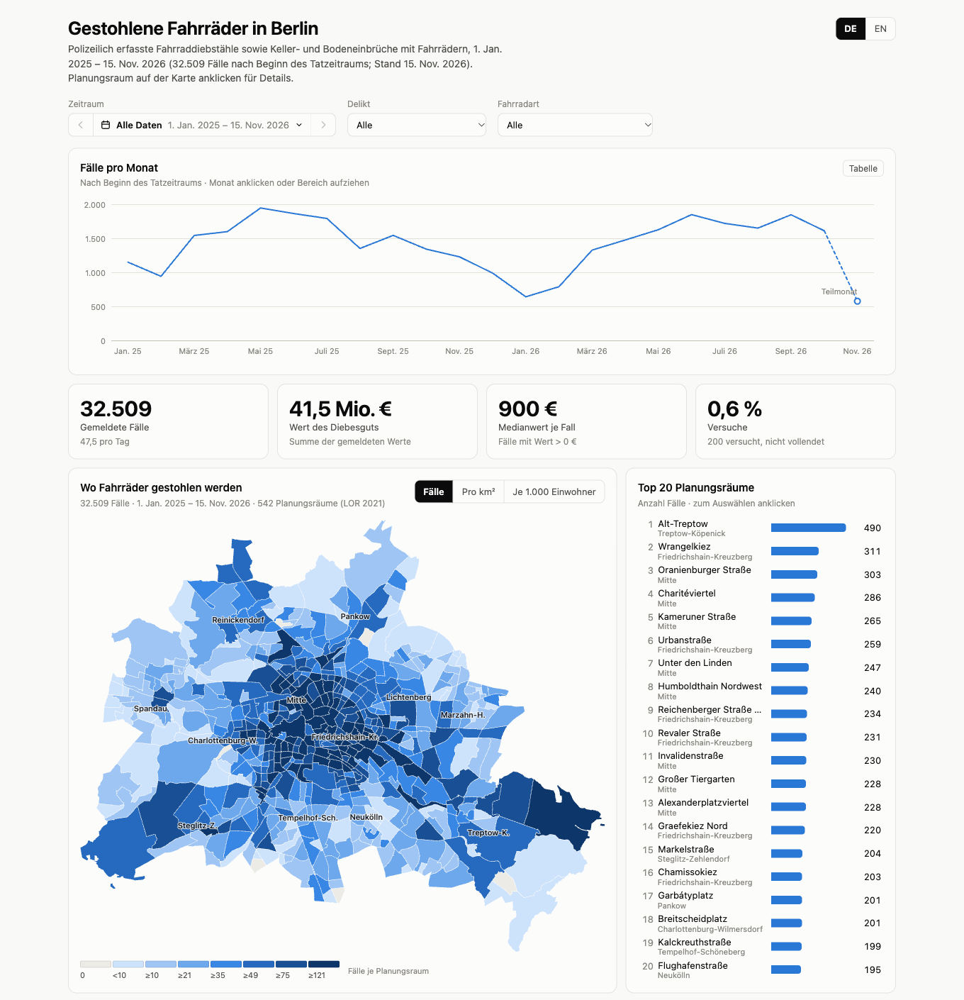

# Stolen bikes in Berlin / Gestohlene Fahrräder in Berlin



**Live: <https://kevin.melchert.xyz/stolen-bikes-berlin/>**

Interactive dashboard for the Berlin police open data set *Fahrraddiebstahl* (bike thefts):
a map of the 542 LOR planning areas (cases, cases per km², cases per 1,000 residents), a top-20
ranking, districts, bike types, time of day and a monthly timeline. Period, offense and bike type can
be filtered; clicking a planning area drills into it. German (default) and English UI. The whole
dashboard is one static file, `index.html`, with no external requests.

## Build

```bash
pip install -r requirements.txt
python3 build.py            # rebuild index.html from the local CSV
python3 build.py --fetch    # download the latest CSV from Polizei Berlin first, then rebuild
```

`build.py` joins the cases to the LOR 2021 planning areas (boundaries and names from
`data_raw/plr_2021.geojson`, residents from `data_raw/ewr/pop_2024.csv`), simplifies the geometry and
inlines everything into `template.html` to produce `index.html`. `index.html` is generated and not
tracked in git; run the build to create it.
`--fetch` refuses anything that is not the expected CSV (web page, wrong columns, too few rows).

## Hosting on GitHub Pages

`.github/workflows/pages.yml` rebuilds the page every day with the latest CSV and deploys it
to GitHub Pages (Settings → Pages → Source: **GitHub Actions**). The downloaded CSV is not committed;
the copy in the repo is only the fallback if the download fails. Run the workflow by hand from the
Actions tab to test it. GitHub disables scheduled workflows in public repos after 60 days without
repository activity; re-enable it from the Actions tab if that happens.

## Data sources and licenses

The code is under the MIT license (see [LICENSE](LICENSE)). The data files in this repository and
shown on the page keep their own licenses and need attribution:

| Data | Source | License (as listed on daten.berlin.de) |
|---|---|---|
| Bike thefts | Polizei Berlin / LKA, [Fahrraddiebstahl in Berlin](https://daten.berlin.de/datensaetze/fahrraddiebstahl-in-berlin) | CC BY |
| Residents per planning area, 31.12.2024 | Amt für Statistik Berlin-Brandenburg, [Einwohner in LOR-Planungsräumen](https://daten.berlin.de/datensaetze/einwohnerinnen-und-einwohner-in-berlin-in-lor-planungsraumen-am-31-12-2024) | CC BY |
| LOR planning-area boundaries, 01.01.2021 | Amt für Statistik Berlin-Brandenburg, via the FIS-Broker WFS ([dataset](https://daten.berlin.de/datensaetze/lebensweltlich-orientierte-raume-lor-01-01-2021-wfs-34c86848)) | CC BY 3.0 DE |

Counts show where cases are reported, not how risky an area is; see the notes at the bottom of the
dashboard for caveats (reported offences only, per-resident rates inflated in commuter and tourist
areas, time windows over 72 h not published).
